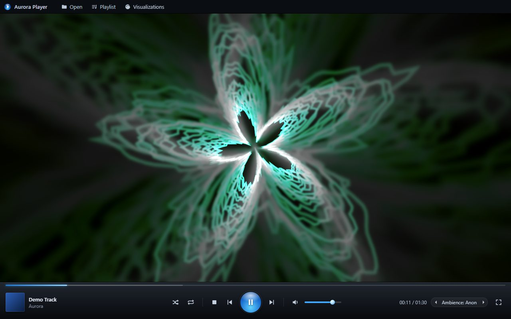
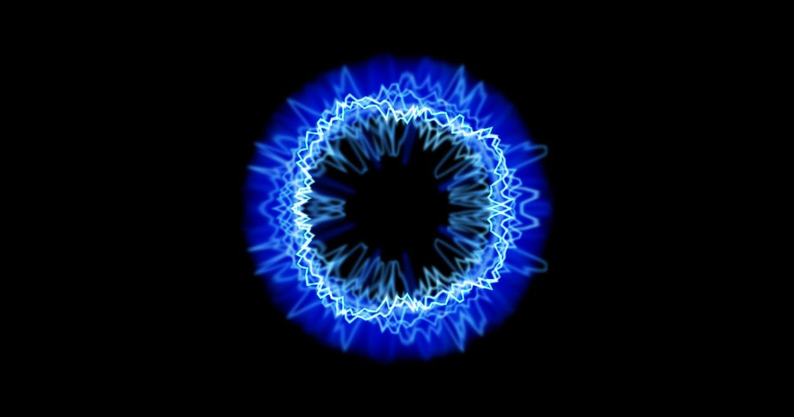
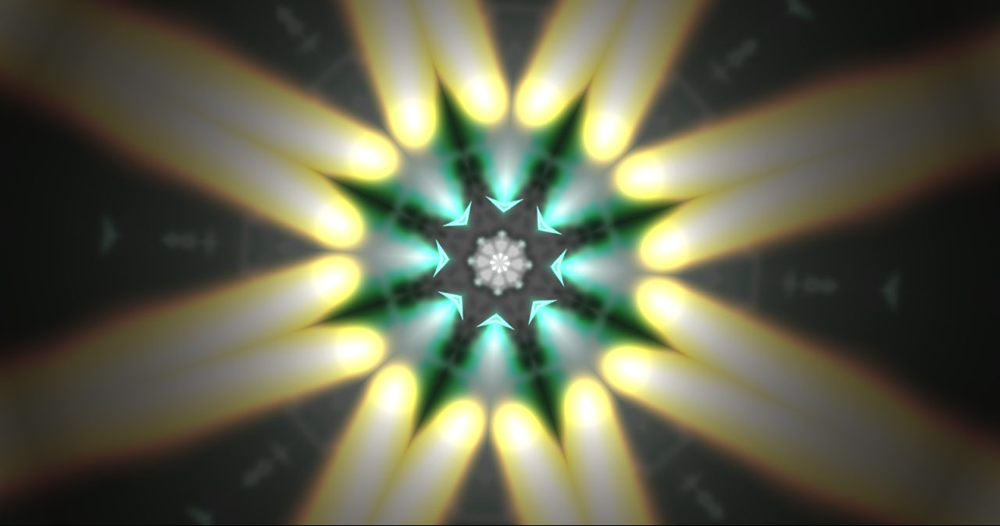
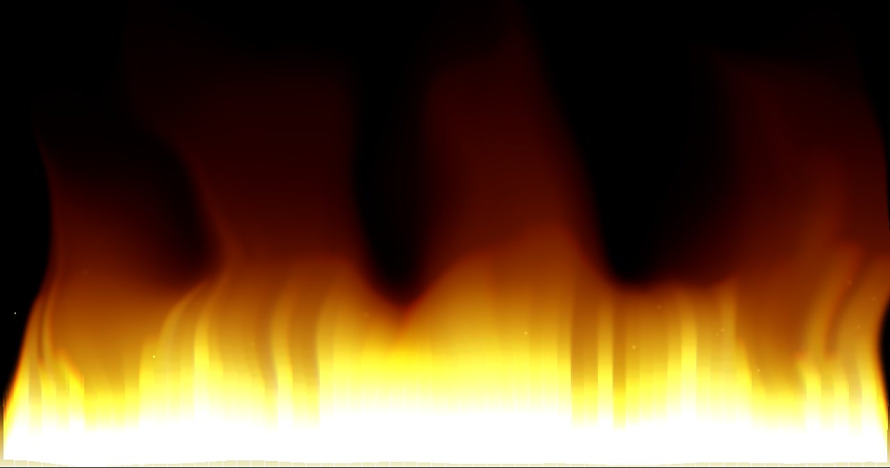
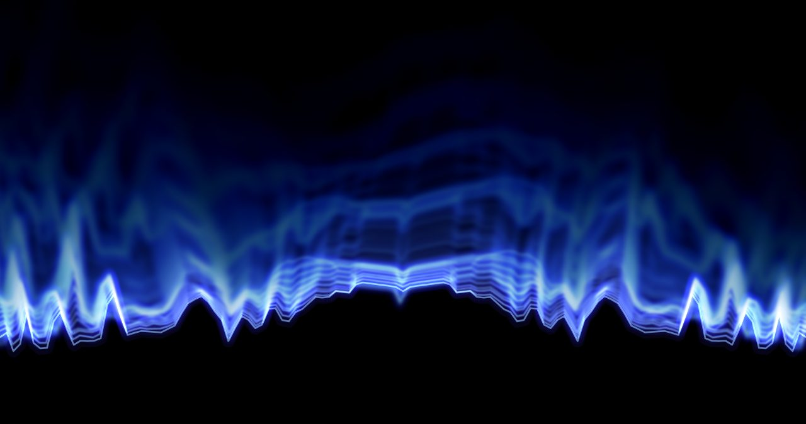
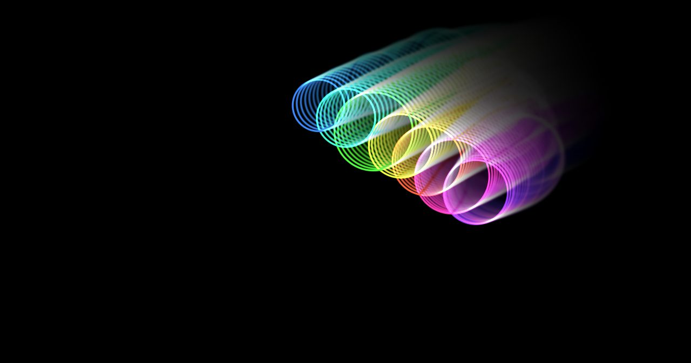

# Aurora Player

A music and video player for Windows that brings back the audio-reactive visualizations of the
classic Windows Media Player.

[](https://github.com/davvoz/sound_player_music_visualizer/releases/latest)
[](https://github.com/davvoz/sound_player_music_visualizer/releases)



<table>
  <tr>
    <td><br><sub>Ambience: Water</sub></td>
    <td><br><sub>Battery: Kaleidovision</sub></td>
  </tr>
  <tr>
    <td><br><sub>Bars and Waves: Fire Storm</sub></td>
    <td><br><sub>Bars and Waves: Ocean Mist</sub></td>
  </tr>
  <tr>
    <td><br><sub>Battery: Dance of the Freaky Circles</sub></td>
    <td><br><sub>Bars and Waves: Bars</sub></td>
  </tr>
</table>

## Installation

1. Download **Aurora-Player-Setup-x.y.z.exe** from the
   [latest release](https://github.com/davvoz/sound_player_music_visualizer/releases/latest) and run it.
   The installer is not digitally signed, so Windows SmartScreen may show a warning:
   choose **More info › Run anyway**.
2. On first launch, Aurora Player asks whether it should become your default player.
   Accept, and Windows opens **Settings › Default apps › Aurora Player**: click **Set default**.

Windows requires you to confirm this step yourself. You can do it later at any time:
right-click inside the player and choose **Set as default player…**.

## Updates

Aurora Player checks for a new version every time it starts. When one is available it shows what's
new and asks whether to download it; once downloaded, you can restart right away or let the update
install when you close the player. You can also check manually: right-click inside the player and
choose **Check for updates…**.

## Playing media

- **Double-click** any supported file in File Explorer.
- **Drag and drop** files or whole folders onto the window. Hold **Ctrl** while dropping, or drop
  onto the playlist, to add them to the queue instead of replacing it.
- **Right-click a file** in File Explorer and choose *Add to Aurora Player playlist*.
- Use **Open** in the top bar, or **Ctrl+O**.

Title, artist and album art are read from the file's tags, or from a `cover.jpg`/`folder.jpg`
in the same folder.

## Visualizations

Visualizations play automatically with audio files. Switch between them with the arrows next to the
visualization name, the **V** key, or the right-click menu.

| Collection | Presets |
| --- | --- |
| Alchemy | Random: morphs into a new look every 10–20 seconds |
| Album Art | Album Cover |
| Ambience | Anon, Blizzard, Bubble, Falloff, Swirl, Warp, Water |
| Bars and Waves | Bars, Fire Storm, Ocean Mist, Scope |
| Battery | Dance of the Freaky Circles, Event Horizon, Kaleidovision |
| Spikes | Cosmic Rays, Fireworks |

To get a different visualization for every track, enable **Change visualization every track** in
the right-click menu.

These are faithful recreations of the original Windows Media Player effects, not the original
Microsoft plug-ins.

## Keyboard shortcuts

| Key | Action |
| --- | --- |
| Space / Ctrl+P | Play / pause |
| Ctrl+F / Ctrl+B | Next / previous track |
| Ctrl+S | Stop |
| Ctrl+O | Open files |
| ← / → | Seek 5 seconds (30 seconds with Ctrl) |
| ↑ / ↓ | Volume |
| M | Mute |
| V / Shift+V | Next / previous visualization |
| L | Show or hide the playlist |
| F11, Alt+Enter, double-click | Full screen |
| Esc | Exit full screen |
| Delete | Remove the selected track from the playlist |

## Supported formats

| Type | Formats |
| --- | --- |
| Audio | MP3, WAV, FLAC, OGG, Opus, M4A, AAC, WebA |
| Video | MP4, M4V, MKV, WebM, MOV, OGV |
| Playlists | M3U, M3U8 |

WMA, WMV and AVI files are not supported.

## Uninstalling

Uninstall from **Settings › Apps › Installed apps**. All file associations created by Aurora Player
are removed. To keep the app but stop it from handling your files, right-click inside the player and
choose **Remove file associations**.

## Building from source

Requires Node.js 20 or later.

```
npm install
npm start        # run in development mode
npm run dist     # build the installer into dist/
```

### Releases

Every push to `master` publishes a new release automatically
([.github/workflows/release.yml](.github/workflows/release.yml)); changes that only touch Markdown files
or `docs/` are skipped. The version number comes from the commit messages since the last release:

| Commit message | Example | New version |
| --- | --- | --- |
| `feat!: …` or a `BREAKING CHANGE` footer | `feat!: new playlist format` | 1.4.2 → 2.0.0 |
| `feat: …` | `feat: add Plenoptic visualizations` | 1.4.2 → 1.5.0 |
| anything else | `fix: seek bar on long tracks` | 1.4.2 → 1.4.3 |

To force a specific version, set it in `package.json` before pushing. The workflow builds the
installer, publishes it with generated release notes, and installed copies offer the update on their
next launch.
